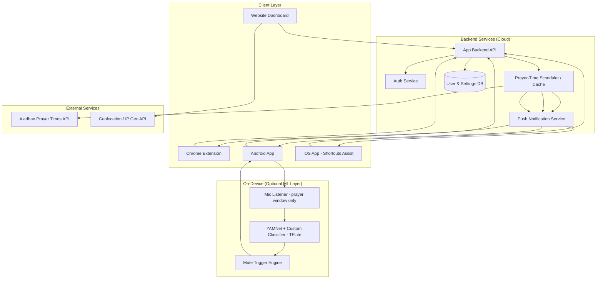
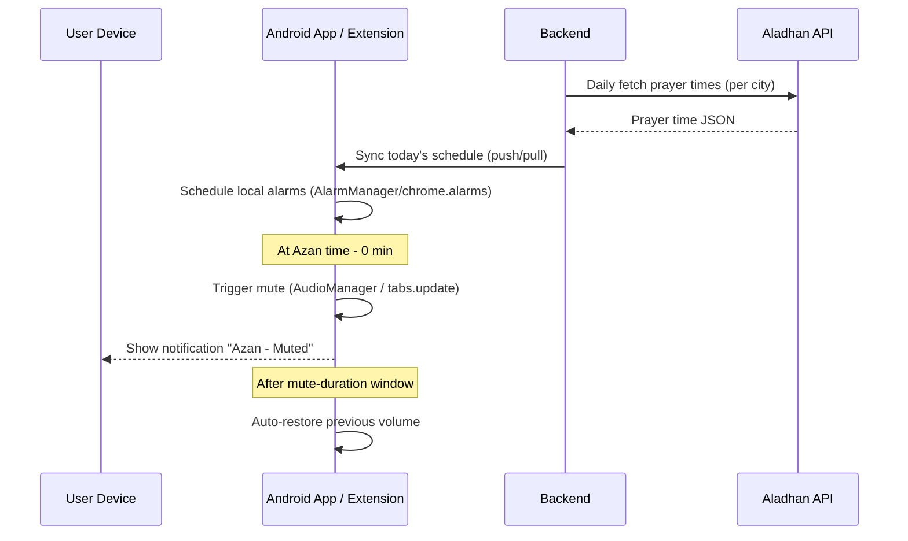
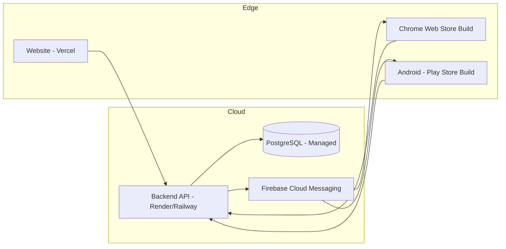

# System Architecture Document
## Project: AzanMute (working title)

---

## 1. Overview

AzanMute is a cross-platform system (Website + Chrome Extension + Mobile App) that automatically mutes device/tab/system audio during Azan (Islamic call to prayer) times, based primarily on prayer-time scheduling, with an optional on-device audio-verification layer for accuracy.

---

## 2. High-Level Architecture Diagram

---

## 3. Component Breakdown

### 3.1 Website (Dashboard)
- User signup/login
- Location & calculation-method configuration
- Mute-duration & per-platform preferences
- Device/extension linking (shows connected Android app / Chrome extension instances)
- Prayer-time calendar view (today + weekly)

### 3.2 Chrome Extension
- Background service worker (Manifest V3)
- Fetches/caches daily prayer times from backend (synced from user's dashboard settings)
- Uses `chrome.alarms` API to schedule mute triggers
- Uses `chrome.tabs.query({audible: true})` + `chrome.tabs.update({muted: true})` at Azan time
- Options page mirrors website settings (or pulls from account via OAuth)

### 3.3 Android App
- Foreground service + `AlarmManager`/`WorkManager` for exact-time triggers
- `AudioManager` for system-wide media volume mute
- Optional: Mic-based YAMNet verification module (only active inside prayer window)
- Local notification: "Azan time — sound muted"

### 3.4 iOS App
- Cannot programmatically mute other apps (OS sandboxing)
- Sends local notification at Azan time
- Deep-links to a pre-configured **Shortcuts** automation the user sets up once (Focus Mode / Do Not Disturb trigger)

### 3.5 Backend API
- REST/GraphQL API (Node.js/NestJS or Django REST recommended)
- Auth (email/OTP or Google login)
- Stores user location, calculation method, mute-duration preference
- Daily job: pre-fetch & cache prayer times per user's city (reduces Aladhan API calls)
- Push notification dispatch (FCM for Android, Web Push for extension)

### 3.6 External: Aladhan API
- Free prayer-times API
- Input: lat/long or city + calculation method (Bangladesh → "Dhaka" or "Karachi" method)
- Output: daily Fajr/Dhuhr/Asr/Maghrib/Isha timings

---

## 4. Data Flow (Azan Trigger Sequence)

---

## 5. Technology Stack Summary

| Layer | Technology |
|---|---|
| Website | Next.js / React + Tailwind |
| Chrome Extension | Manifest V3, TypeScript |
| Android App | Flutter or Kotlin (native recommended for AudioManager reliability) |
| iOS App | Flutter or Swift (limited scope) |
| Backend | Node.js (NestJS) or Django REST |
| Database | PostgreSQL |
| Prayer Times | Aladhan API |
| Push Notifications | Firebase Cloud Messaging (Android), Web Push (Chrome) |
| ML (optional) | YAMNet + TensorFlow Lite (on-device) |
| Hosting | Vercel/Netlify (web), Railway/Render (backend), Firebase (push) |

---

## 6. Deployment Topology

